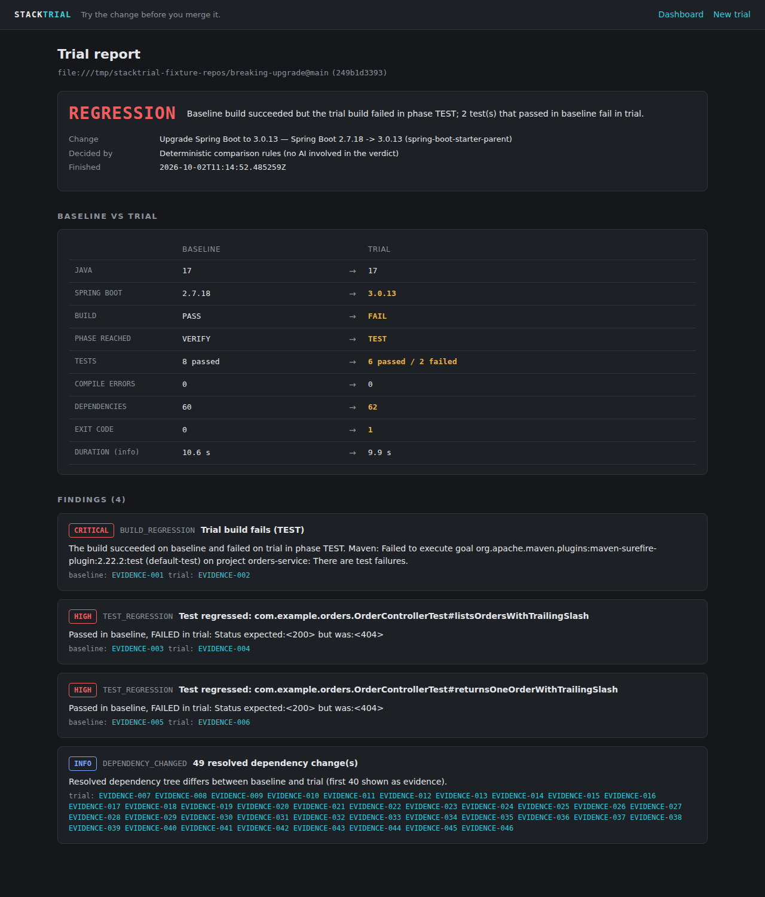

# STACKTRIAL

> **Try the change before you merge it.**

StackTrial takes a Java / Spring Boot / Maven repository and a proposed change (a dependency version, a Spring Boot version, a Java version, or a unified git diff), then:

1. clones the repository at a baseline ref,
2. runs the **baseline** with `mvn verify` in a disposable Docker container,
3. applies the change to a separate copy and runs the **trial** in an equivalent container,
4. parses the real evidence: exit code, phase reached, compile errors, Surefire results, dependency tree, logs,
5. compares baseline and trial with **deterministic rules** that produce findings and a verdict,
6. retrieves relevant Spring Boot / Java migration documentation (RAG on PostgreSQL + pgvector),
7. asks **Gemini** to explain the findings, citing evidence ids and documentation ids.

**Evidence first, AI second.** The verdict (`PASS`, `REGRESSION`, `IMPROVEMENT`, `BOTH_FAILED`, `INCONCLUSIVE`) is computed by Java code. Gemini only explains it. Without Gemini, the report is still complete.



## What a real run shows

Fixture `breaking-upgrade` is a Spring Boot 2.7 service. Upgrading it to 3.0.13 (real containers, 2026-10-02):

```text
VERDICT        REGRESSION    Baseline build succeeded but the trial build failed in phase TEST;
                             2 test(s) that passed in baseline fail in trial.
BUILD          PASS     → FAIL
PHASE REACHED  VERIFY   → TEST
TESTS          8 passed → 6 passed / 2 failed     Status expected:<200> but was:<404>
DEPENDENCIES   60       → 62                      49 resolved version changes
DOCUMENTATION  KB-SB30-03  Spring MVC and WebFlux: trailing slash matching disabled
```

All saved outputs: [docs/scenario-results/](docs/scenario-results/).

---

## Run it

Full details and troubleshooting: [docs/RUNBOOK.md](docs/RUNBOOK.md).

### 1. Prerequisites
JDK 21, Maven 3.9+, Docker (running), git. `curl` and `jq` for the API examples. Linux or macOS (Windows: WSL2). Runner containers need internet access for Maven downloads.

### 2. Configure environment variables (optional)
```bash
cp .env.example .env              # set GEMINI_API_KEY here if you have one
set -a; . ./.env; set +a          # export the values into this shell
```

### 3. Start PostgreSQL + pgvector
```bash
docker compose up -d
```

### 4. Build (and test)
```bash
cd backend
mvn clean verify                  # 72 tests, needs Docker; or: mvn clean package -DskipTests
```

### 5. Start Spring Boot
```bash
java -jar target/stacktrial-0.1.0-SNAPSHOT.jar
```

### 6. Open the UI
<http://localhost:8080>

### 7. Create the demo repositories (second terminal, repository root)
```bash
sh fixtures/create-demo-repos.sh
```

### 8–9. Create the first trial: baseline and trial run in Docker
UI → **New trial**: repository `file:///tmp/stacktrial-fixture-repos/breaking-upgrade`, ref `main`, change `SPRING_BOOT_VERSION`, target `3.0.13`. The progress page shows the baseline container, then the trial container. Or with the API:

```bash
ID=$(curl -s -X POST localhost:8080/api/trials -H 'Content-Type: application/json' \
  -d '{"repoUrl":"file:///tmp/stacktrial-fixture-repos/breaking-upgrade","baselineRef":"main","changeType":"SPRING_BOOT_VERSION","targetVersion":"3.0.13"}' \
  | jq -r .trialId)
until [ "$(curl -s localhost:8080/api/trials/$ID | jq -r .finished)" = true ]; do sleep 5; done
```

### 10. View the comparison
```bash
curl -s localhost:8080/api/trials/$ID | jq '{verdict, verdictReason, comparison: [.comparison[] | "\(.label): \(.baseline) -> \(.trial)"]}'
```
or open `http://localhost:8080/trials/<id>`.

### 11. View the AI explanation
```bash
curl -s localhost:8080/api/trials/$ID | jq .explanation
```
In the UI: section **Why did it fail?**. Without `GEMINI_API_KEY` it is marked unavailable and shows the documentation found by full-text search.

### All four demo scenarios
```bash
sh scripts/run-demo-scenarios.sh  # saves reports and logs to docs/scenario-results/
```

| # | Change | Observed |
|---|---|---|
| 1 | `breaking-upgrade`: Spring Boot 2.7.18 → 3.0.13 | `REGRESSION` (2 trailing-slash tests 200 → 404) |
| 2 | `passing-upgrade`: commons-lang3 3.13.0 → 3.17.0 | `PASS` |
| 3 | `passing-upgrade`: Java 17 → 21 | `PASS` (trial on the temurin-21 image) |
| 4 | `passing-upgrade`: diff calling a missing method | `REGRESSION` (phase COMPILE, `cannot find symbol … truncateMiddle`) |

A public GitHub repository works the same way (`https://github.com/spring-projects/spring-petclinic`, Java 21: `PASS`, 77 tests on both sides).

## Environment variables

| Variable | Default | Purpose |
|---|---|---|
| `DATABASE_URL` / `DATABASE_USERNAME` / `DATABASE_PASSWORD` | compose values | PostgreSQL |
| `GEMINI_API_KEY` | empty | Enables embeddings (vector retrieval) and the AI explanation |
| `GEMINI_CHAT_MODEL` / `GEMINI_EMBEDDING_MODEL` | `gemini-2.5-flash` / `gemini-embedding-001` | Models |
| `STACKTRIAL_DATA_DIR` | `./data` | Workspaces, collected results, logs |
| `STACKTRIAL_RUN_TIMEOUT` | `15m` | Hard timeout per container |
| `STACKTRIAL_RUNNER_NETWORK` | `bridge` | Docker network for runner containers |
| `STACKTRIAL_ALLOW_LOCAL_REPOS` | `true` | Accept `file:///` repositories |

Behind a corporate HTTPS proxy: [backend/config/application-proxy.example.yml](backend/config/application-proxy.example.yml).

## Architecture

```text
Browser ─▶ web (Thymeleaf + REST) ─▶ trial (orchestrator, bounded worker pool, state in PostgreSQL)
                                        ├─▶ workspace   git clone, baseline + trial copies, ChangeApplier per change type
                                        ├─▶ execution   ContainerRunner (docker-java) ─────────▶ Docker Engine
                                        ├─▶ evidence    Surefire XML, dependency tree, build log parsers
                                        ├─▶ comparison  pure-Java rules → findings + verdict
                                        └─▶ explanation retrieval (pgvector / full text) + LlmClient (Gemini)
PostgreSQL 16 + pgvector (Flyway): trial, trial_run, test_result, evidence, finding, explanation, knowledge_chunk
```

Stack: Java 21, Spring Boot 3.5.16, Maven, PostgreSQL 16 + pgvector, Flyway, docker-java 3.7, Thymeleaf, Gemini REST, JUnit 5, Mockito, Testcontainers. Deliberately not used: Kafka, Redis, Kubernetes, microservices, Gradle, a JS framework.

## Documentation

| Document | Content |
|---|---|
| [docs/PROJECT_FLOW.md](docs/PROJECT_FLOW.md) | One trial from click to report, class by class |
| [docs/ARCHITECTURE.md](docs/ARCHITECTURE.md) | Modules, lifecycle, failure handling, decisions, scaling path |
| [docs/CODE_STRUCTURE.md](docs/CODE_STRUCTURE.md) | Every important file: why, what, who calls it, what it calls |
| [docs/DATABASE.md](docs/DATABASE.md) | Tables, relationships, real rows |
| [docs/API.md](docs/API.md) | Every endpoint with real requests and responses |
| [docs/DOCKER_FLOW.md](docs/DOCKER_FLOW.md) | Container lifecycle and isolation controls |
| [docs/EVIDENCE_ENGINE.md](docs/EVIDENCE_ENGINE.md) | Parsers and `RunEvidence` |
| [docs/COMPARISON_ENGINE.md](docs/COMPARISON_ENGINE.md) | Findings and the verdict decision table |
| [docs/RAG_FLOW.md](docs/RAG_FLOW.md) | Knowledge base, ingestion, retrieval |
| [docs/GEMINI_FLOW.md](docs/GEMINI_FLOW.md) | Prompt, API calls, reliability controls, verification status |
| [docs/TESTING.md](docs/TESTING.md) | Test suites, counts, what is real vs replaced |
| [docs/RUNBOOK.md](docs/RUNBOOK.md) | Commands, scenarios, troubleshooting |
| [docs/INTERVIEW_GUIDE.md](docs/INTERVIEW_GUIDE.md) | Pitches, 60 Q&As, learning path, how to explain it |
| [BUILD_REPORT.md](BUILD_REPORT.md) | What was built and verified, and what was not |
| [PROJECT.md](PROJECT.md) · [CLAUDE.md](CLAUDE.md) | Project record and working rules |

## Status and limitations

Verified on 2026-10-02: 72 unit/integration tests + 1 real-Docker e2e test pass; four demo scenarios and a GitHub repository ran through real Docker; UI and every API endpoint checked. **Gemini has not been called live** (no API key was available); the integration is implemented and tested with a stub. See [BUILD_REPORT.md](BUILD_REPORT.md) for the full list of limitations.

Main limitations: Maven only (root `pom.xml`); runner images for Java 17 and 21; runner containers have network access during builds; shared Maven cache; trials do not survive a restart (marked `FAILED`); no flaky-test detection; single-user, no authentication, bound to 127.0.0.1.
