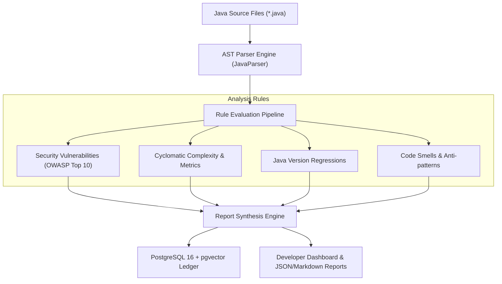

# StackShield — Static Codebase Analyzer for Java

<p align="center">
  
  
  
  
  
</p>

## 📌 Executive Summary

**StackShield** is an automated developer tooling platform engineered for deterministic static analysis of enterprise Java codebases. It performs deep Abstract Syntax Tree (AST) inspection to detect security vulnerabilities, calculate cyclomatic complexity, flag code smells, and prevent version upgrade regressions before deployment.

---

## 🎯 Problem Statement
In enterprise Java microservices, security vulnerabilities (such as unsafe deserialization, SQL injection, hardcoded credentials) and technical debt often slip past code reviews. Existing enterprise analysis tools are frequently closed-source, heavy, or require external SaaS subscriptions that pose intellectual property risks.

## 💡 Solution
StackShield provides a self-hosted, deterministic static inspection engine:
1. Parses Java source files into Abstract Syntax Trees (AST) using JavaParser.
2. Executes rule-based checks across **Security Risks**, **Code Smells**, **Cyclomatic Complexity**, and **Version Regressions**.
3. Stores project analysis snapshots and vector embeddings in PostgreSQL with `pgvector`.
4. Generates structured, actionable JSON and Markdown remediation reports.

---

## 🏗️ System Architecture



---

## 🛠️ Verified Technology Stack

| Category | Component / Technology | Purpose |
|---|---|---|
| **Core Language** | Java 17 (OpenJDK) | High-performance multi-threaded AST analysis |
| **Backend Framework** | Spring Boot 3.x | REST API, service orchestrator, configuration |
| **AST Engine** | JavaParser | Source-to-AST tokenization and semantic node traversal |
| **Database** | PostgreSQL 16 + pgvector | Snapshots, code metrics, and semantic vulnerability search |
| **DevOps & Containers** | Docker & Docker Compose | Multi-container development with pre-configured pgvector |
| **Build & Tooling** | Apache Maven | Build lifecycle, dependency management, automated tests |

---

## 📁 Project Structure

```
stackshield/
├── backend/                  # Java Spring Boot analyzer backend
│   ├── src/main/java/        # Rule engines, AST visitors, and API endpoints
│   └── pom.xml               # Maven dependencies and build plugins
├── deploy/                   # Deployment scripts and container manifests
├── docs/                     # Technical specifications and architectural guides
├── fixtures/                 # Java code fixtures for test verification
├── public/                   # Web-based inspection dashboard assets
├── scripts/                  # CI/CD and utility execution scripts
├── docker-compose.yml        # PostgreSQL 16 + pgvector container definition
├── BUILD_REPORT.md           # Compilation and testing verification log
├── PROJECT.md                # Engineering roadmap and design documentation
└── README.md                 # Primary project documentation
```

---

## 🚀 Getting Started

### Prerequisites
- **JDK 17+** (Eclipse Temurin or OpenJDK recommended)
- **Apache Maven 3.8+**
- **Docker Desktop** (for containerized PostgreSQL with pgvector)

### Installation & Local Setup

1. **Clone the repository:**
   ```bash
   git clone https://github.com/purvgandhi/stackshield.git
   cd stackshield
   ```

2. **Start the database container:**
   ```bash
   docker-compose up -d
   ```

3. **Configure Environment Variables:**
   Copy `.env.example` to `.env`:
   ```bash
   cp .env.example .env
   ```

4. **Build and Run Backend:**
   ```bash
   mvn clean package
   mvn spring-boot:run
   ```

---

## 🛡️ Security & Quality Standards
- **Zero Credentials in Code:** Database passwords and external connection strings are loaded strictly via environment variables.
- **Deterministic Rules:** Analysis runs locally on the host machine without external network transmission of proprietary source code.

---

## 👨‍💻 Author & Contributions
- **Author:** [Purv Gandhi](https://github.com/purvgandhi)
- **LinkedIn:** [linkedin.com/in/purv-gandhi-17989330a](https://www.linkedin.com/in/purv-gandhi-17989330a/)
- **Institution:** Department of Information Technology, D.J. Sanghvi College of Engineering, Mumbai
